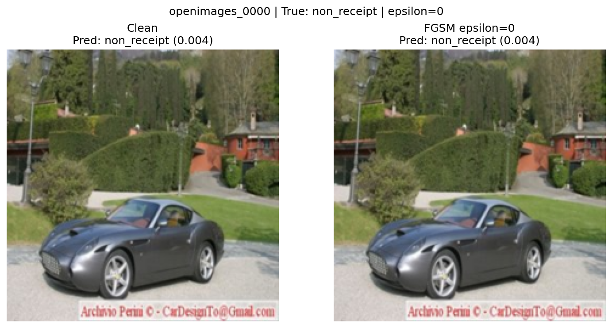
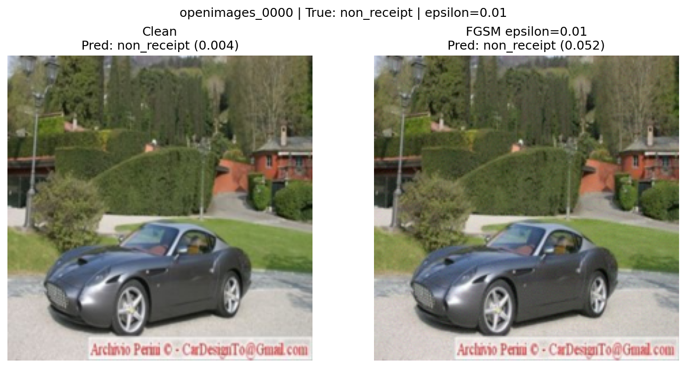
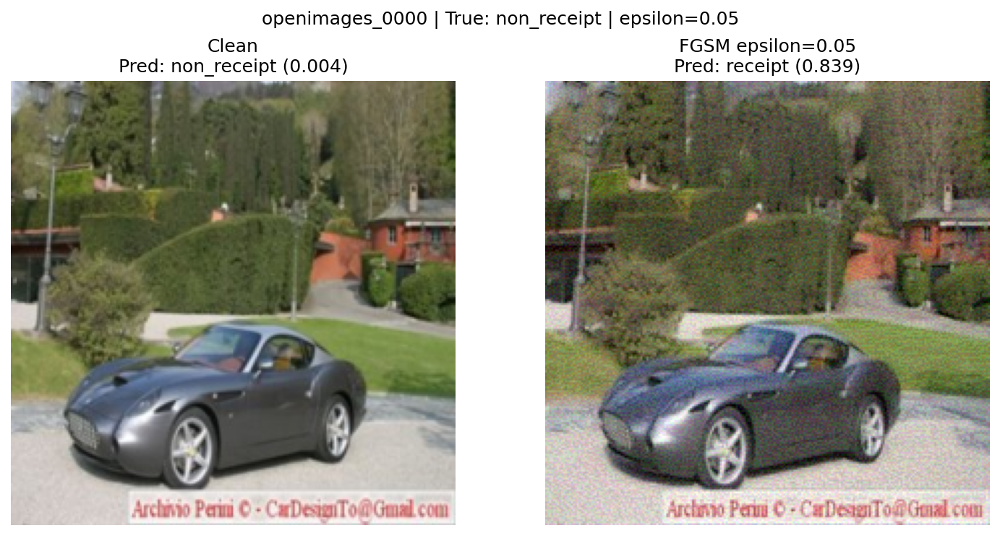
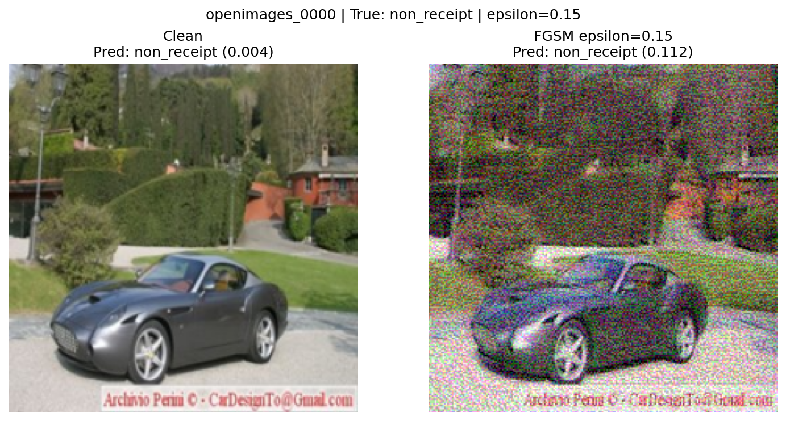

# FGSM Evasion Attack Results

## Clean Model Baseline

Command: `python evaluate.py --model-path checkpoints/receipt_cnn_clean.pt --test-dir balanced_data/test` (390 test images: 195 receipt, 195 non_receipt; positive class = `receipt`).

- **Model:** ReceiptCNN (`receipt_cnn_clean.pt`, 25,921 parameters)
- **Test accuracy:** 0.9436
- **Precision:** 0.9943 | **Recall:** 0.8923 | **F1:** 0.9405
- **Confusion matrix** (rows = true, cols = predicted, order `non_receipt, receipt`): `[[194, 1], [21, 174]]`
- **FGSM baseline:** at ε = 0.000 the perturbation is `0 × sign(∇)` = 0, so the adversarial image is pixel-identical to the clean image, and adversarial accuracy (0.9436) exactly matches the `evaluate.py` baseline. This confirms the attack loop is correct and that all later degradation is caused by the perturbation, not by the evaluation code.

## FGSM Results

Command: `cd attacks && python 01_fgsm_evasion.py` → `attacks/results/01_fgsm/fgsm_results.json`. Attack success rate = images that were classified correctly before the attack and wrongly after it, divided by all images classified correctly before it (368).

| Epsilon | Clean Accuracy | Adversarial Accuracy | Attack Success Rate |
|---------|---------------|---------------------|-------------------|
| 0.000 | 0.9436 | 0.9436 | 0.0000 |
| 0.010 | 0.9436 | 0.8077 | 0.1440 |
| 0.030 | 0.9436 | 0.5103 | 0.4592 |
| 0.050 | 0.9436 | 0.3000 | 0.6821 |
| 0.100 | 0.9436 | 0.2718 | 0.7120 |
| 0.150 | 0.9436 | 0.4462 | 0.5272 |

Per-class breakdown of adversarial predictions (true → predicted), from re-running the same attack:

| Epsilon | receipt → receipt | receipt → non_receipt | non_receipt → non_receipt | non_receipt → receipt |
|---------|------------------|----------------------|--------------------------|----------------------|
| 0.030 | 46 | 149 | 153 | 42 |
| 0.050 | 2 | 193 | 115 | 80 |
| 0.100 | 0 | 195 | 106 | 89 |
| 0.150 | 0 | 195 | 174 | 21 |

## Visual Evidence

Same test sample at every ε: `openimages_0000` (a photo of a car, true label `non_receipt`). The value in brackets is the model's receipt probability.

**ε = 0.000:** identical images, `non_receipt (0.004)`. The control case.

**ε = 0.010:** no visible difference, even side by side. The receipt score rises 13× (0.004 → 0.052) but the prediction holds. Across the test set, 14% of correct predictions already flip.

**ε = 0.030:** a faint grain is visible only when compared directly with the original; on its own the image looks like a normal, slightly noisy JPEG. The score reaches 0.403, just below the 0.5 threshold. Test-set accuracy is already down to 51%.

**ε = 0.050:** **the prediction flips: a car photo is accepted as a `receipt` (0.839).** There is light, even noise, similar to a low-light phone photo, and the car and scene are fully recognizable. This is the attacker's sweet spot: the model has failed while a reviewer would at most see "a grainy photo".

**ε = 0.100:** still `receipt` (0.889), but the noise is now obvious, with coloured speckle across the whole image. A human reviewer would likely flag it as tampered or corrupted.

**ε = 0.150:** heavy, clearly artificial noise, and the prediction falls back to `non_receipt` (0.112). Too much perturbation pushes the image past the "receipt" region the gradient pointed to.

**Visual degradation vs. model failure:** the model starts failing at ε = 0.01 (14% of correct predictions flipped, with no visible change), reaches coin-flip accuracy (51.0%) by ε = 0.03, and falls below 50% by ε = 0.05 (30.0%). The image only becomes clearly degraded to a human at ε ≈ 0.10. So there is a window, roughly ε = 0.01–0.05, where the classifier is badly fooled and a human reviewer sees nothing suspicious. That window is exactly what an attacker exploits.

## Analysis

1. **At what epsilon does accuracy drop below 50%?** At ε = 0.05 (30.0%). Accuracy is already at coin-flip level by ε = 0.03 (51.0%, just above the 50% line), then crosses below it at ε = 0.05. The minimum is 27.2% at ε = 0.10, far below random guessing for a balanced binary task. FGSM doesn't just add confusion; it pushes predictions specifically toward the wrong class.

2. **How do you interpret the attack success rate?** It's the share of the 368 correctly classified images that a single gradient step turns into errors: 14% at ε = 0.01, 46% at 0.03, 68% at 0.05, peaking at 71% at 0.10. Degradation is gradual and steep up to 0.10. At ε = 0.15 the rate *drops* to 53% and accuracy rises to 44.6%, but this isn't robustness. The per-class table shows the model collapses to predicting `non_receipt` for almost everything (195/195 receipts and 174/195 non-receipts). The "recovered" accuracy is non-receipts being right by default. FGSM is a single linear step; at large ε it overshoots the region where that linear approximation holds, and the saturated noise looks "non-receipt-like" to the CNN. The two directions also differ. Receipts are far more fragile: 100% of receipts are misclassified from ε = 0.10. Non-receipt → receipt peaks at 89/195 (46%) at ε = 0.10.

3. **Would these perturbations be visible to a human?** At ε ≤ 0.03 (≤ 8/255 per pixel), no: they read as normal sensor or JPEG noise. At ε = 0.05 (≈13/255) they are noticeable only as mild graininess. At ε ≥ 0.10 (≈26/255) they are obvious coloured speckle. Since the model is already at coin-flip accuracy (51.0%) by ε = 0.03 and below 50% by ε = 0.05 — both in the imperceptible range — an attacker can reach a high success rate while staying visually undetectable.

4. **What are the implications for the expense system?**
   - **Fraud:** an employee with access to the model (or a surrogate trained on similar data, as FGSM perturbations transfer between models) can make a non-receipt image, such as a personal photo, pass as a valid receipt, as the ε = 0.05 car example shows. Automated approval would let fake expenses through.
   - **Denial of service and evasion:** the receipt → non_receipt direction is even easier (100% of receipts flipped at ε = 0.10). Valid receipts can be made to fail, either to disrupt the system or to keep a receipt away from automated checks.
   - **A human in the loop is not a reliable backstop** in the ε ≤ 0.05 range, because reviewers see a normal-looking photo.
   - **Root cause:** the model is fully differentiable and was trained only on clean data, and its augmentation (crop, flip, rotation, colour jitter) does nothing against worst-case L∞ perturbations. BatchNorm and dropout regularize training but give no adversarial robustness.
   - **Mitigations:** adversarial training (FGSM/PGD examples mixed into training); input preprocessing (JPEG re-compression, slight blur or denoising, bit-depth reduction) before inference; keep model weights and gradients private (no white-box access); reject or flag low-confidence predictions (e.g., 0.3–0.7) for manual review; and cross-check with OCR (a real receipt must contain readable totals and dates).
