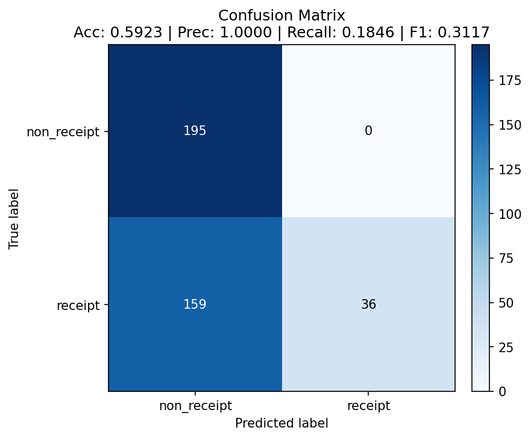

# Data Poisoning Results

## Attack Configuration

- **Method:** Label-flip poisoning. Training images are moved into the opposite class folder with a `flipped_<original-class>_` prefix. `ImageFolder` derives labels from folder names, so moving a file flips its label without touching a pixel.
- **Primary attack — targeted (prototypical) flip:** 115 receipt images (9.97% of the 1,154 training labels, within the ≤10% limit) are relabelled `non_receipt`. The 115 are not random: they are the receipts a clean surrogate model scores as the **most prototypical** (highest receipt confidence). An attacker flips the clearest examples, not random ones. The exact set is pinned in `attacks/prototypical_manifest.txt` so the result reproduces on any machine.
- **Test split:** untouched. `diff -rq balanced_data/test poisoned_data/test` reports no differences; every model is scored on the same 390 clean images (195 / 195).
- **Training:** the provided `train.py` (15 epochs, Adam 1e-3, seed 42) on CPU for determinism.
- **Goal:** show that an insider who can write to the training folders can corrupt a small, well-chosen slice of labels — invisible at the pixel level — and collapse the model's ability to recognize receipts.

## Label Flip Evidence

Each row shows a clean training image beside its poisoned copy. The pixels are identical (same file, moved); only the label changed — real receipts are now labelled `non_receipt`. A pixel-level data check or a reviewer skimming thumbnails would find nothing wrong; only re-checking each label against its image reveals the attack.

## Baseline (Clean Model)

Provided checkpoint `receipt_cnn_clean.pt` on the clean test set (`attacks/results/02_label_flip/clean/metrics.json`):

| Metric | Value |
|--------|-------|
| Accuracy | 0.9436 |
| Precision | 0.9943 |
| Recall | 0.8923 |
| F1 Score | 0.9405 |

## Poisoned Model

`receipt_cnn_poisoned.pt`, retrained on the targeted-poison dataset (`attacks/results/02_label_flip/poisoned/metrics.json`):

| Metric | Value |
|--------|-------|
| Accuracy | 0.5923 |
| Precision | 1.0000 |
| Recall | 0.1846 |
| F1 Score | 0.3117 |

## Impact Analysis

Clean vs. poisoned, both on the same clean test set:

| Metric | Clean | Poisoned | Change |
|--------|-------|----------|--------|
| Accuracy | 0.9436 | 0.5923 | **−0.3513 (−35.1 pts)** |
| Precision | 0.9943 | 1.0000 | +0.0057 |
| Recall | 0.8923 | 0.1846 | **−0.7077** |
| F1 | 0.9405 | 0.3117 | −0.6288 |

The targeted attack drops accuracy by **35 percentage points** — far past the 5-point bar — by flipping under 10% of labels. The damage is entirely in **recall**: the poisoned model correctly identifies only 36 of 195 receipts (18%), classifying the other 159 as `non_receipt`. Precision actually rises to 1.000 because the model has become so reluctant to call anything a receipt that it never produces a false positive.

### Why targeting matters: random flips do almost nothing

The same classifier is strikingly robust to *random* label noise. Flipping the same budget at random leaves clean-test accuracy essentially unchanged:

| Poison strategy | Flipped | Accuracy | vs. clean (0.9436) |
|-----------------|---------|----------|--------------------|
| None (clean baseline) | 0 | 0.9436 | — |
| Random, symmetric | 5% (28+28) | 0.9667 | +2.3 (noise) |
| Random, symmetric | 10% (57+57) | 0.9385 | −0.5 |
| Random, one-directional | 10% of labels | 0.9487 | +0.5 (noise) |
| **Targeted (prototypical) receipt→non_receipt** | **10% (115)** | **0.5923** | **−35.1** |

Random flips are averaged out by the network (BatchNorm + 15 epochs): with 90%+ of labels still correct, the majority signal dominates and the noisy minority is ignored. The run-to-run variance of a bare retrain (clean models trained in-environment ranged 0.905–0.944) is larger than any random-flip effect, so **accuracy monitoring would not detect random poisoning at all.**

Targeting defeats that robustness. By removing and mislabelling the *clearest* receipts, the attack strips the class of its strongest, most representative examples and simultaneously teaches the model that prototypical receipts are `non_receipt`. The decision boundary moves decisively, and receipt recall collapses.

### A tipping-point effect (honest caveat)

The collapse sits at a threshold. Flipping the 115 clearest receipts as scored by a *surrogate* clean model yields 0.5923 (reproduced across 4 identical retrains). Selecting the "most prototypical" 115 with the *provided* model instead lands at ~0.91–0.92 (a 2–3 point drop) — just short of the cliff. Because nearly-identical poison sets fall on opposite sides of the threshold, the **magnitude** of a targeted attack is sensitive to exactly which samples are chosen; the committed `prototypical_manifest.txt` pins a set that reliably crosses it. The qualitative finding is robust regardless: random poisoning is harmless here, targeted poisoning is devastating.

## Confusion Matrices

Rows = true class, columns = predicted (`non_receipt`, `receipt`).

Clean `[[194, 1], [21, 174]]` → poisoned `[[195, 0], [159, 36]]`. The non_receipt row is nearly unchanged (195/195 correct), but the receipt row inverts: 159 of 195 receipts are now misclassified as `non_receipt`. The poisoning damaged exactly the class whose prototypes were flipped.

## Key Findings

1. **How significant is the accuracy drop?** 35 percentage points (0.9436 → 0.5923) from flipping under 10% of training labels — a severe, unambiguous degradation, well past the 5-point threshold.

2. **Which class was more affected and why?** The **receipt** class, catastrophically: recall fell from 0.89 to 0.18. The attack flipped prototypical *receipts* to `non_receipt`, so the model learned that receipt-like images belong to `non_receipt`. The `non_receipt` class was untouched and its recall stayed at 1.00, which is also why precision rose to 1.00 (no false positives remain).

3. **What do the confusion matrices tell you?** The entire shift is in the receipt row (174→36 correct). Poisoning didn't add random confusion; it drove a specific, one-directional failure — exactly the attacker's intent.

4. **What are the implications of this attack?**
   - **Targeting beats volume.** An attacker does not need to corrupt a lot of data — under 10%, well chosen, is enough to break the model. This is far more realistic and dangerous than random corruption.
   - **Accuracy gates are insufficient.** Random poisoning hides under accuracy monitoring; targeted poisoning that *does* move accuracy still ships if there is no clean, trusted reference and no per-class checks.
   - **Stealth.** The images are unchanged, the pipeline runs normally, and only the labels (folder placement) are wrong — invisible to a pixel-level data scan.
   - **Mitigations:** make training data immutable, versioned and hash-verified; store labels in a signed manifest rather than deriving them from folder names; run label-noise / confident-learning detection before training; gate releases on per-class recall and a trusted holdout, not just overall accuracy; and compare each retrain against a clean reference so real degradation is distinguishable from training variance.
