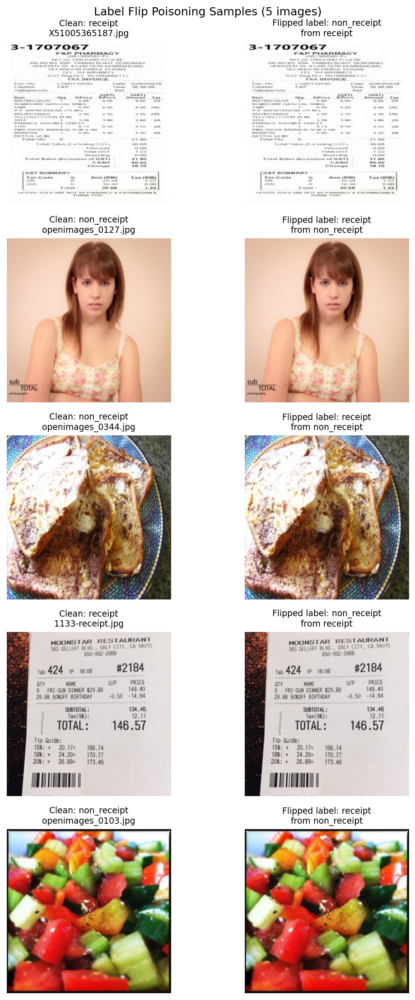
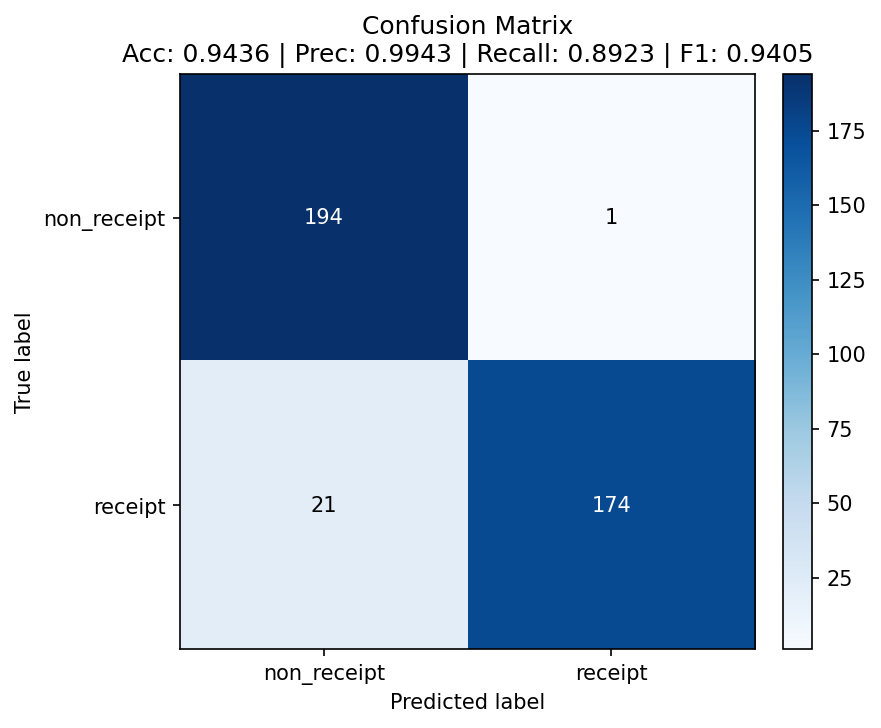

# Data Poisoning Results

## Attack Configuration

- **Method:** Label-flip poisoning. Training images are moved into the opposite class folder with a `flipped_<original-class>_` prefix. `ImageFolder` takes labels from folder names, so moving a file flips its label without touching a pixel.
- **Flip rate:** 5% per class (default, `--flip-rate 0.05`). A 10% run (the allowed maximum) was added as a second data point; the script rejects rates above 10%.
- **Labels flipped:** 56 out of 1,154 training images (4.85%): 28 receipt → non_receipt and 28 non_receipt → receipt. In the 10% run, 114 out of 1,154 (9.88%).
- **Test split:** untouched. `diff -rq balanced_data/test poisoned_data/test` reports no differences, so every model is scored on the same 390 clean images (195 / 195).
- **Goal:** show that an insider who can write to the training folders can corrupt a small share of labels, leaving no trace in the images themselves, and shift the model's decision boundary in a way that clean evaluation data reveals.

## Label Flip Evidence

Each row shows the clean training image next to its poisoned copy. The pixels are identical (the same file, moved). Only the label changed: two real receipts (F&P Pharmacy, Moonstar Restaurant) are now labelled `non_receipt`, and three non-receipts (a portrait, toast, salad) are labelled `receipt`. A pixel-level data check or a reviewer skimming images would find nothing wrong; only re-checking each label against its image reveals the attack.

## Baseline (Clean Model)

Provided checkpoint `receipt_cnn_clean.pt` (`attacks/results/02_label_flip/clean/metrics.json`):

| Metric | Value |
|--------|-------|
| Accuracy | 0.9436 |
| Precision | 0.9943 |
| Recall | 0.8923 |
| F1 Score | 0.9405 |

## Poisoned Model

`receipt_cnn_poisoned.pt`, retrained on `poisoned_data/` (5%) with the provided `train.py`, defaults of 15 epochs, Adam 1e-3 and seed 42 (`attacks/results/02_label_flip/poisoned/metrics.json`):

| Metric | Value |
|--------|-------|
| Accuracy | 0.9667 |
| Precision | 0.9840 |
| Recall | 0.9487 |
| F1 Score | 0.9661 |

## Impact Analysis

The page's required comparison (provided clean model vs. 5% poisoned model):

| Metric | Clean | Poisoned | Change |
|--------|-------|----------|--------|
| Accuracy | 0.9436 | 0.9667 | +0.0231 |
| Precision | 0.9943 | 0.9840 | −0.0103 |
| Recall | 0.8923 | 0.9487 | +0.0564 |
| F1 | 0.9405 | 0.9661 | +0.0256 |

On headline accuracy the poisoned model looks *better*. Before attributing that to the poisoning, I retrained a **clean control** on the unpoisoned data in the same environment (same script, seed, hardware), and added the 10% run. All four models are scored on the same clean test set:

| Model | Train data | Accuracy | Precision | Recall | F1 | False positives (non_receipt → receipt) | Mean confidence* | Uncertain predictions (0.2 < p < 0.8) | Test BCE loss |
|-------|-----------|----------|-----------|--------|----|------|------|------|------|
| Clean (provided) | clean | 0.9436 | 0.9943 | 0.8923 | 0.9405 | 1 | 0.856 | 60 | 0.180 |
| Clean (retrained here) | clean | 0.9051 | 0.9938 | 0.8154 | 0.8958 | 1 | 0.856 | 60 | 0.242 |
| Poisoned 5% | 4.85% flipped | 0.9667 | 0.9840 | 0.9487 | 0.9661 | 3 | 0.786 | 50 | 0.155 |
| Poisoned 10% | 9.88% flipped | 0.9385 | 0.9777 | 0.8974 | 0.9358 | 4 | 0.630 | 137 | 0.266 |

\* Mean of `2·|p − 0.5|` over the test set: 1.0 = fully confident, 0 = coin flip.

Final training loss (epoch 15): clean retrained **0.077**, poisoned 10% **0.383**.

## Confusion Matrices (Optional)

Rows = true class, columns = predicted (`non_receipt`, `receipt`).

Clean `[[194, 1], [21, 174]]` → poisoned 5% `[[192, 3], [10, 185]]` → poisoned 10% `[[191, 4], [20, 175]]` (`results/02_label_flip/poisoned_10/confusion_matrix.png`). The clean control is `[[194, 1], [36, 159]]` (`results/02_label_flip/clean_retrained/`).

## Key Findings

1. **How significant is the accuracy drop?** At 5% and 10% random, symmetric flips, there is **no accuracy drop that can be separated from training noise**. Two clean training runs differ by 3.9 points (0.944 vs. 0.905) with no poisoning at all, which is larger than any poisoned-vs-clean gap. The +2.3-point "improvement" of the 5% model is therefore run-to-run variance (different weight initialization, non-deterministic GPU (MPS) kernels, and a reshuffled data order because the poisoned folders contain different files), not a benefit of poisoning. Against the same-environment clean control, the 10% model is +3.3 points, so headline accuracy says nothing either way. This is a finding in itself: **standard accuracy monitoring would not detect this attack.** Random symmetric label noise acts like regularization; with 90–95% of labels still correct, the CNN learns the majority signal and largely ignores the noisy minority.

2. **Which class was more affected and why?** The effect that appears consistently is on the **non_receipt class: false positives rise 1 → 3 → 4** as the flip rate goes from 0% to 5% to 10%, so **precision falls steadily (0.994 → 0.984 → 0.978)** in every poisoned model and in neither clean model. The flipped `non_receipt → receipt` samples teach the model that some ordinary photos (portraits, food) count as receipts, which widens the "receipt" region of the decision boundary. Receipt recall moves around (0.82–0.95) with no pattern related to the flip rate; it is the class most sensitive to training noise, because receipts vary more (thermal paper, crumpled, photographed at angles) than they differ from the non_receipt photos.

3. **What do the confusion matrices tell you?** The top-right cell (non-receipt accepted as receipt) is the only cell that grows steadily with the poisoning rate. The bottom-left cell (receipts rejected) swings between 10 and 36 across runs and does not follow the flip rate. That is the signature of training variance rather than the attack.

   The strongest evidence of the poisoning is in **confidence, not accuracy**:
   - Mean confidence drops from 0.856 to 0.786 at 5% and to **0.630 at 10%**.
   - The number of test images in the uncertain 0.2–0.8 band more than doubles at 10% (60 → **137**).
   - The 10% model cannot fit its own training set: its final training loss is 0.383, against 0.077 for the clean model, because about 10% of labels contradict the images.

   The poisoned model still gets most answers right, but with much less margin, so a small push (e.g., the FGSM perturbation from Attack 1) is far more likely to flip its decisions.

4. **What are the implications of this attack?**
   - **Stealth:** a few dozen moved files keep the pipeline running and the accuracy dashboard green, yet the model becomes measurably more permissive (more non-receipts accepted) and far less confident. Accuracy-only release gates would ship it.
   - **The real risk is targeted flipping.** This experiment used *random* flips in both directions, which is the weakest form of the attack. An insider who moves only `non_receipt → receipt` examples, or only samples resembling a specific fraudulent document, would push the boundary in one chosen direction with the same small budget. The steady false-positive increase seen here is the early sign of that.
   - **Compounding with evasion:** lower confidence margins make the model easier to fool with adversarial inputs (Attack 1).
   - **Mitigations:**
     - Make training data immutable and versioned (hash manifests, write access restricted, every change reviewed).
     - Store labels in a signed manifest, not derived from folder names.
     - Detect label noise before training (e.g., cleanlab or confident learning, flagging samples the model persistently disagrees with; here the 10% model's high final training loss is itself a warning sign).
     - Add release gates that check precision, per-class error and confidence calibration on a trusted holdout set, not just accuracy.
     - Train several runs and compare against a clean reference so that real degradation can be told apart from training noise.
